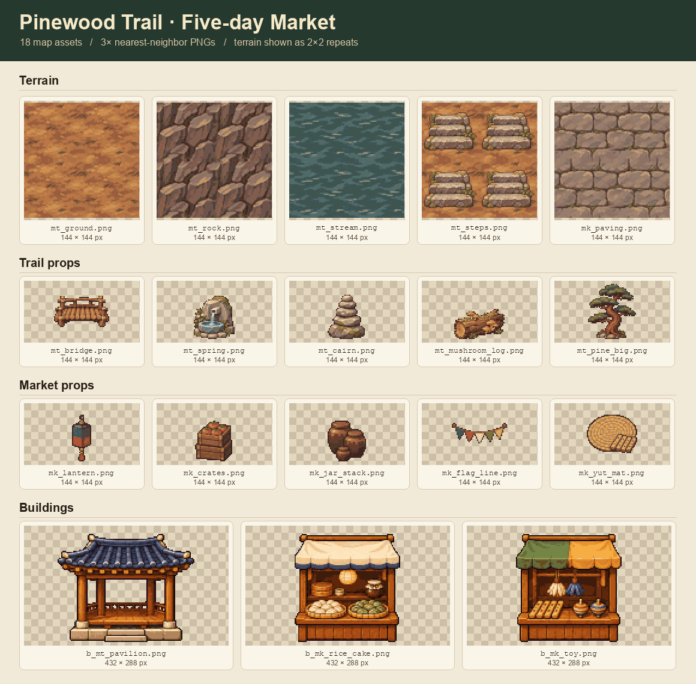
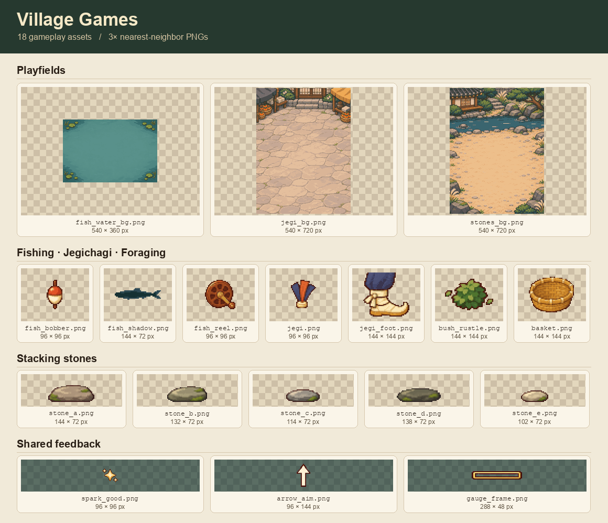

# 솔숲 산길·오일장터와 마을 놀이 픽셀 아트

런타임 PNG 36장과 재생성용 원본 36장을 제공한다. 경로 기준은 `apps/mobile/assets/game/rpg/`이다. 원본은 `maps2-src/`와 `play-src/`에 있고, 3배 최근접 확대 PNG는 `pixel/maps2/`와 `pixel/play/`에 있다.

## 솔숲 산길·오일장터



| `pixel/maps2/` 파일 | 용도 | 그리드 → PNG | 배경 |
| --- | --- | --- | --- |
| `mt_ground.png` | 솔잎 흙길 | 48×48 → 144×144 | 불투명 |
| `mt_rock.png` | 바위 절벽 | 48×48 → 144×144 | 불투명 |
| `mt_stream.png` | 계곡물 | 48×48 → 144×144 | 불투명 |
| `mt_bridge.png` | 통나무 다리 | 48×48 → 144×144 | 투명 |
| `mt_steps.png` | 흙길 위 돌계단 | 48×48 → 144×144 | 불투명 |
| `mt_spring.png` | 약수터 | 48×48 → 144×144 | 투명 |
| `mt_cairn.png` | 돌탑 | 48×48 → 144×144 | 투명 |
| `mt_mushroom_log.png` | 버섯 난 통나무 | 48×48 → 144×144 | 투명 |
| `mt_pine_big.png` | 큰 소나무 | 48×48 → 144×144 | 투명 |
| `mk_paving.png` | 장터 돌 포장 | 48×48 → 144×144 | 불투명 |
| `mk_lantern.png` | 청사초롱 | 48×48 → 144×144 | 투명 |
| `mk_crates.png` | 과일 상자 더미 | 48×48 → 144×144 | 투명 |
| `mk_jar_stack.png` | 장터 항아리 | 48×48 → 144×144 | 투명 |
| `mk_flag_line.png` | 만국기 줄 | 48×48 → 144×144 | 투명 |
| `mk_yut_mat.png` | 윷놀이 멍석 | 48×48 → 144×144 | 투명 |
| `b_mt_pavilion.png` | 산 정자 | 144×96 → 432×288 | 투명 |
| `b_mk_rice_cake.png` | 떡집 좌판 | 144×96 → 432×288 | 투명 |
| `b_mk_toy.png` | 전통 놀이 좌판 | 144×96 → 432×288 | 투명 |

불투명 타일은 상하·좌우 끝 픽셀을 맞췄다. 돌계단은 솔잎 흙길과 같은 바탕을 쓴다. 다리·만국기·멍석은 타일 중앙에 배치했고, 나머지 맵 소품과 건물은 하단을 기준으로 배치했다.

## 낚시·제기차기·돌탑·채집



| `pixel/play/` 파일 | 용도 | 그리드 → PNG | 배경 |
| --- | --- | --- | --- |
| `fish_bobber.png` | 낚시찌 | 32×32 → 96×96 | 투명 |
| `fish_shadow.png` | 수중 물고기 그림자 | 48×24 → 144×72 | 투명 |
| `fish_water_bg.png` | 가로 연못 수면 | 180×120 → 540×360 | 불투명 |
| `fish_reel.png` | 낚시 릴 손잡이 | 32×32 → 96×96 | 투명 |
| `jegi.png` | 제기 | 32×32 → 96×96 | 투명 |
| `jegi_bg.png` | 세로 장터 마당 | 180×240 → 540×720 | 불투명 |
| `jegi_foot.png` | 한복 바지와 신발 옆모습 | 48×48 → 144×144 | 투명 |
| `stone_a.png` | 넓은 강돌 | 48×24 → 144×72 | 투명 |
| `stone_b.png` | 둥근 녹회색 강돌 | 44×24 → 132×72 | 투명 |
| `stone_c.png` | 좁은 회색 강돌 | 38×24 → 114×72 | 투명 |
| `stone_d.png` | 길고 낮은 강돌 | 46×24 → 138×72 | 투명 |
| `stone_e.png` | 작은 밝은 강돌 | 34×24 → 102×72 | 투명 |
| `stones_bg.png` | 세로 계곡 물가 | 180×240 → 540×720 | 불투명 |
| `bush_rustle.png` | 잎이 흩날리는 덤불 | 48×48 → 144×144 | 투명 |
| `basket.png` | 대바구니 | 48×48 → 144×144 | 투명 |
| `spark_good.png` | 성공 반짝임 | 32×32 → 96×96 | 투명 |
| `arrow_aim.png` | 위쪽 조준 화살표 | 32×48 → 96×144 | 투명 |
| `gauge_frame.png` | 가로 게이지의 빈 틀 | 96×16 → 288×48 | 투명 |

돌 5종은 바닥선을 맞췄다. 게이지는 바깥과 채움 영역이 모두 투명하다. 수중 그림자는 물고기 외형이 그대로 드러난 첫 생성본을 어두운 실루엣으로 교체했다.

## 재생성

저장소 루트에서 실행한다. `sprite-gen`의 Codex 프로바이더와 `gpt-6.2-sol`로 만든 원본을 잘라 512px 이하로 저장했으며, 재생성은 저장된 원본만으로 실행된다.

```sh
npm --prefix tools/pixel-art ci
node tools/pixel-art/pixelize.mjs --only=maps2,play
```
